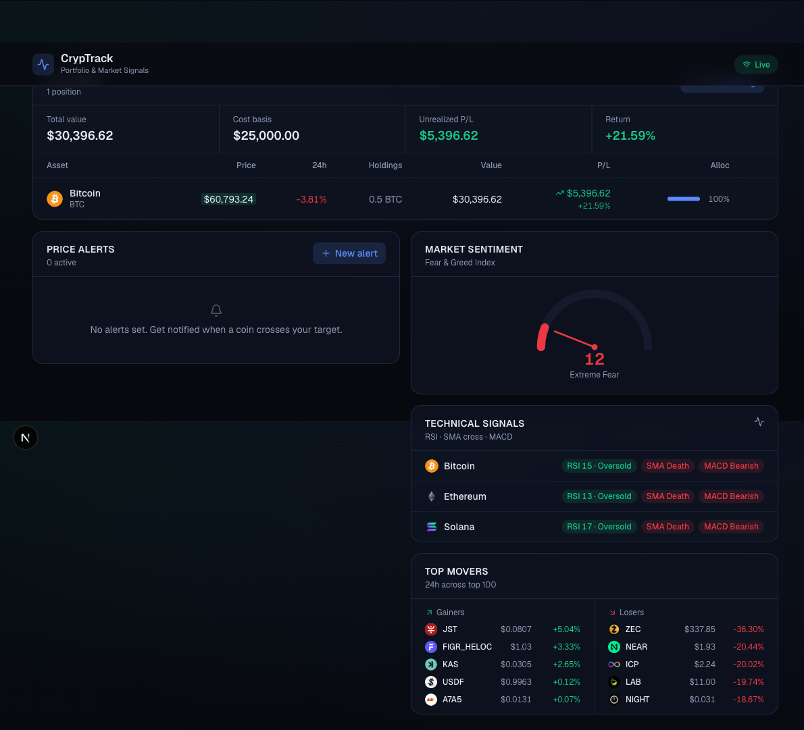

# CrypTrack 🚀
**Institutional-Grade Personal Crypto Portfolio Management & Market Intelligence**

CrypTrack is a full-featured, local-first crypto portfolio management and research application powered entirely by free, open-source crypto APIs (Binance Spot & Futures, DeFiLlama, CoinGecko Public/Demo Proxy, Alternative.me, and Frankfurter FX). Zero required paid subscriptions.



---

## 🌟 Core Features

### 1. 💼 Portfolio Hub & Multi-Bucket Transaction Ledger
- **Multiple Portfolio Buckets**: Organize assets into isolated strategies (`Core Long-Term`, `Tactical Alpha`, `DeFi Yield`, or custom buckets).
- **Comprehensive Ledger**: Log `BUY`, `SELL`, `TRANSFER_IN`, and `TRANSFER_OUT` transactions with execution prices, fees, timestamps, and notes.
- **Accurate Cost Basis**: Dynamic Weighted-Average Dollar Cost Averaging (DCA) accounting.
- **P&L Separation**: Realized P&L tracked separately upon sales; Unrealized P&L calculated against real-time streaming market prices.
- **Asset Allocation**: Visual allocation bars and diversification breakdown.
- **Backup & Restore**: 1-click JSON backup/restore and CSV transaction export/import.

### 2. 🧭 Multi-Factor Recommendation Engine & Hypothesis Research
- **4-Pillar Quantitative Model (0–100% Score)**:
  - **Technical Momentum (30%)**: Multi-timeframe EMA alignment (20/50/200), RSI momentum, MACD histogram expansion, and 24h volume.
  - **On-Chain Fundamentals (25%)**: DeFiLlama 7d & 30d TVL growth and protocol revenue generation.
  - **Macro & Derivatives (25%)**: Binance Perpetual Funding Rates (short squeeze vs overleveraged froth) and Fear & Greed contrarian cycle context.
  - **Risk-Reward & Market Structure (20%)**: Distance to auto-detected support vs resistance levels with $\ge 2:1$ asymmetric R:R filtering.
- **Hypothesis Archetypes**:
  - `DeFi Cashflow Accumulation`
  - `Momentum Breakout`
  - `Oversold Value Reversal`
  - `Ecosystem Narrative Leader`
- **Actionable Execution Levels**: Suggested Entry Zone, Target 1, Target 2, and Hard Invalidation Stop for every candidate.

### 3. 🌐 Market Intelligence & Macro Hub
- **Global Crypto Capitalization**: Total Market Cap, 24h Volume, Bitcoin Dominance (BTC.D), and Ethereum Dominance (ETH.D).
- **Stablecoin Liquidity Radar**: Total circulating supply across USDT, USDC, USDS, DAI, USDe, and 7-day net liquidity delta from DeFiLlama.
- **Derivatives Leverage Barometer**: Benchmark perpetual funding rates, annualized funding %, and Squeeze Warning Meter.
- **14-Day Sentiment Timeline**: Alternative.me Fear & Greed historical trend.

### 4. ⚡ Watchlist & Real-Time Signals
- **Sub-Second Streaming Prices**: Live price ticks via Binance WebSocket.
- **Multi-Timeframe Confluence Matrix**: 1H, 4H, 1D, 1W indicator matrix (RSI, SMA 20/50 cross, MACD).
- **Top 24h Movers**: Gainers and decliners across top 100 assets.
- **Price Alerts**: Custom price alerts with in-app toasts and browser notifications.

### 5. 🔍 Interactive Coin Deep-Dive Drawer
- Interactive candlestick chart (Lightweight-Charts) with timeframes (`15m`, `1h`, `4h`, `1d`, `1w`).
- Dynamic Support & Resistance levels plotted with touch counts.
- Technical indicator ribbons (RSI, MACD, EMA 20/50/200, Bollinger Bands).
- Direct "+ Trade" action to log positions immediately.

---

## 🛠️ Tech Stack
- **Framework**: [Next.js 16](https://nextjs.org) (App Router, Turbopack)
- **UI & Styling**: React 19, Tailwind CSS v4, Lucide Icons, Recharts
- **Charts**: [Lightweight Charts](https://tradingview.github.io/lightweight-charts/) (TradingView)
- **State Management**: [Zustand](https://github.com/pmndrs/zustand) with local storage persistence
- **Open APIs**: Binance Spot & Futures, DeFiLlama, CoinGecko, Alternative.me, Frankfurter FX

---

## 🚀 Getting Started

1. **Clone the repository**:
   ```bash
   git clone https://github.com/antrang/CrypTrack.git
   cd CrypTrack
   ```

2. **Install dependencies**:
   ```bash
   npm install
   ```

3. **Start the development server**:
   ```bash
   npm run dev
   ```

4. Open [http://localhost:3000](http://localhost:3000) in your browser.

---

## 📄 License
MIT License. Free and open source for personal use.
